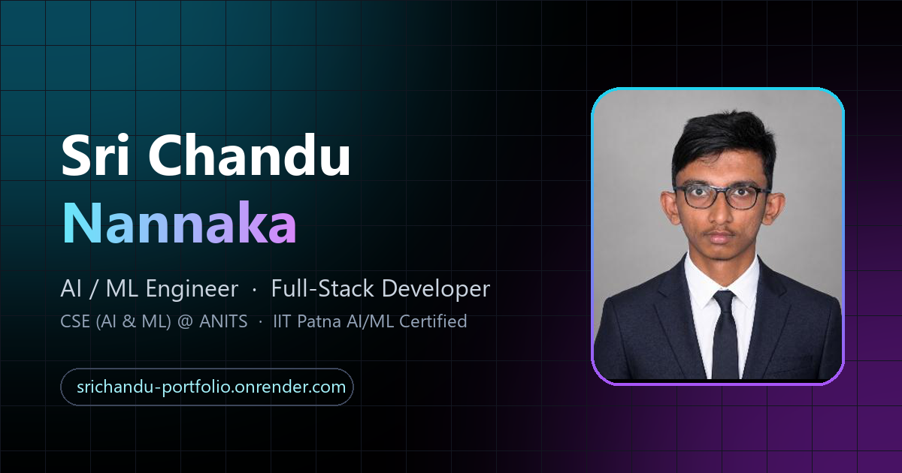

# Sri Chandu Nannaka — Portfolio

**Live site: https://srichandu-portfolio.onrender.com**



Animated personal portfolio built with **React 18 + Vite**, **Tailwind CSS**, **Framer Motion** and **Lenis** smooth scroll.

## Run locally

```bash
npm install
npm run dev        # http://localhost:5173
npm run build      # production build into dist/
```

Add `?skip` to the URL to skip the intro loader while developing.

## Edit content

Everything (bio, experience, projects, skills, certifications) lives in [`src/data.js`](src/data.js).
Replace `public/profile.png` for a new photo and `public/resume.pdf` for a new resume.

## Deploy

**Vercel (recommended)**
1. Push this folder to a GitHub repo.
2. On vercel.com → *Add New Project* → import the repo.
3. Vercel auto-detects Vite (build: `npm run build`, output: `dist`). Click **Deploy**.

**Render**
1. *New* → **Static Site** → connect the repo.
2. Build command: `npm install && npm run build` · Publish directory: `dist`.
